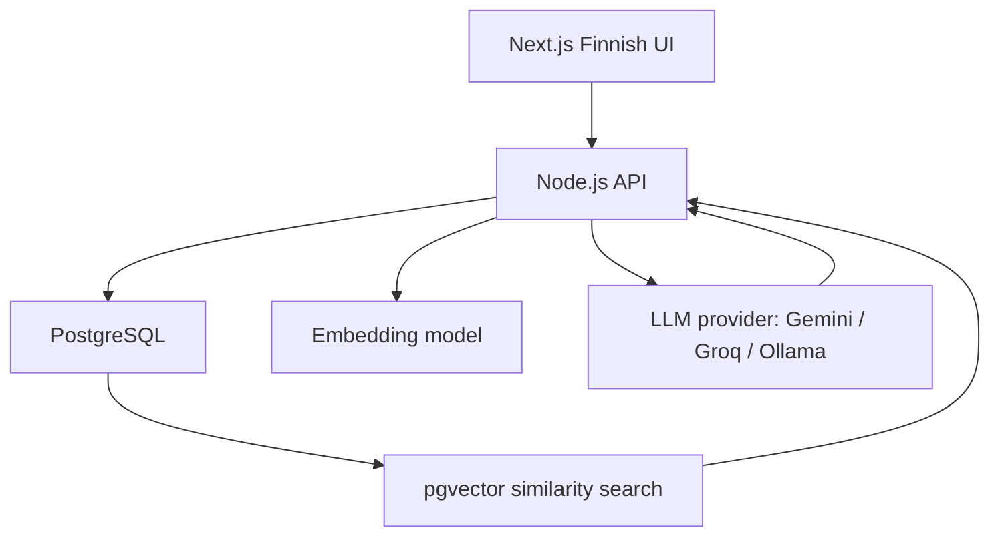

<div align="center">

# 🎓 JalaCampus AI

**A Finnish-language, AI-powered university knowledge assistant — built as a professional higher-education portfolio project.**


*Designed and maintained by **Jussi Alanen** · [juzapala@gmail.com](mailto:juzapala@gmail.com)*

</div>

---

## ✨ Overview

JalaCampus AI is a university-oriented demo that aims to make study guides, course information and campus instructions easier to find. The final concept combines a **Finnish-language chat interface**, **retrieval-augmented generation (RAG)**, **PostgreSQL + pgvector**, and an exchangeable LLM provider.

> [!IMPORTANT]
> **Current status:** This repository includes a responsive UI and a session-only PDF/TXT document preview. Server-side PostgreSQL ingestion, Gemini chunk embeddings and semantic search work as tested command-line tools, and in local development the **Keskustelu** view shows matching source passages. AI-generated answers and RAG **are planned**, not implemented, and the deployed demo has no database. The interface deliberately avoids fabricated answers and citations.

### 🧭 Demo features

| | Module | Status |
| --- | --- | --- |
| 💬 | Finnish chat UI | ✅ UI scaffold |
| 📄 | PDF/TXT document preview | ✅ Session-only demo |
| 🗃️ | Persistent document catalog & ingestion | 🗓️ Planned |
| 🔎 | Semantic search over sample documents | ✅ CLI and local UI (search results, no AI answer) |
| 🤖 | Grounded AI answers (RAG) | 🗓️ Planned |
| 📚 | Course information API | 🗓️ Planned |
| 🛡️ | Grounded answers and source citations | 🗓️ Planned |
| ⚙️ | Configurable model provider | 🗓️ Planned |

## 🎨 Visual language

A professional **light-only** interface: clean white surfaces, `#F8FAFC` background, `#2563EB` primary blue, `#0F172A` text and `#E2E8F0` borders. Built with **Tailwind CSS v4**, responsive layouts and Lucide icons. **All user-facing copy is in Finnish**; source code and engineering documentation are in English.

## 🧱 Architecture (target)



The flow above describes the **target architecture**, not the current state. For the demo, use only synthetic or appropriately licensed public sample documents. Do not include real student records or secrets.

## 🚀 Quick start

Requires Node.js 20.9+ (Node.js 22 LTS recommended).

```bash
npm install
npm run dev
```

Open [http://localhost:3000](http://localhost:3000).

```bash
npm run lint
npm run typecheck
npm test
npm run build
```

Database integration tests (`tests/*.db.test.mjs`) are skipped unless `TEST_DATABASE_URL` is set. They drop and truncate tables, so they refuse to run unless the database name ends in `_test`. With the local Docker service running, create one with `docker compose exec db createdb -U jalacampus jalacampus_test`. CI always runs them against a disposable pgvector container.

`.env.example` documents local database and Gemini embedding settings; no API key or database is required to run the UI scaffold.

## 📄 Document preview

The **Dokumentit** tab accepts synthetic or licensed public PDF and UTF-8 TXT samples up to 2 MB. A Node.js route extracts up to 10 PDF pages and returns at most 20,000 characters for preview. The document list stays in the current page session only; files are not persisted, indexed, or sent to an AI provider. The demo has no admin authentication, so do not upload student records or other private material.

## 🗃️ Vector storage foundation

M2 adds a PostgreSQL/pgvector schema in `db/migrations/`, a deterministic Unicode-safe text chunker, and a server-side ingestion module (`src/lib/ingestion.ts`). Ingestion stores a document and its chunks in one transaction. The document ID is the SHA-256 of the normalized text, so ingesting the same content again changes nothing. Ingestion is command-line only. Search is also available in the local UI (see below); the deployed app has no database. 
Chunk embeddings use Google's **`gemini-embedding-2`** model on the free Gemini API tier, at 768 dimensions with an HNSW cosine index (`db/migrations/002_chunk_embeddings.sql`). The adapter in `src/lib/embeddings.ts` sits behind a small `Embedder` interface so another provider can replace it. `npm run db:embed` embeds every chunk that has no embedding, or one from a different model, and can be re-run safely. Each vector records its model; changing the model or dimension needs a new migration and re-embedding.

### Try semantic search locally

With the Docker database running and `GEMINI_API_KEY`, `POSTGRES_PASSWORD` and `DATABASE_URL` in `.env`:

```bash
npm run db:migrate
npm run db:ingest -- data/samples        # synthetic Finnish documents; re-running changes nothing
npm run db:search -- "Unohdin salasanani, mitä teen?"
```

`db:ingest` accepts UTF-8 `.txt` files and directories (PDF ingestion is not supported yet) and embeds new chunks when a key is set. `db:search` prints the closest chunks with their cosine score, source document, chunk number and chunk ID. Scores rank results but are not calibrated relevance probabilities: an unrelated question still returns its nearest chunks, so the M3 chat must apply its own evidence threshold. `searchChunks` in `src/lib/search.ts` only compares vectors produced by the same embedding model.

### Search in the local UI

Run `npm run dev` with the same `.env` and ask a question in the **Keskustelu** view. `POST /api/search` returns the closest chunks, which the UI shows as source passages with document, chunk number, similarity and chunk ID. They are clearly labelled as **search results, not an AI answer**. The route is disabled with a Finnish notice unless both `DATABASE_URL` and `GEMINI_API_KEY` are set, so deployments without them never call Gemini. It validates input (1–500 characters, 4 KB body) and applies a simple in-memory limit of 20 searches per minute per client. Before any public deployment it needs a shared or platform-level rate limit.

`GEMINI_API_KEY` is read only on the server and must never be exposed through a `NEXT_PUBLIC_` variable. Free-tier rate limits are low and may change; the adapter retries rate-limit and server errors with backoff. Embedding sends chunk text to Google, and free-tier content may be used to improve Google's products, so **only embed synthetic or appropriately licensed public documents**. Tests and CI use a deterministic fake embedder and never call the Gemini API.

Apply pending migrations with `npm run db:migrate`. It reads `DATABASE_URL` (from the environment or a local `.env`) and records applied files in `schema_migrations`.

### Local PostgreSQL with Docker

Run `./dev up` to start the local PostgreSQL/pgvector service and `./dev down` to stop it. Use `./dev restart` to force-recreate the service, `./dev status` to check it, or `./dev logs` to follow its logs. The named volume keeps data between restarts; `docker compose down -v` also deletes local database data. Then run `npm run db:migrate`. Set `POSTGRES_PASSWORD` in a local, untracked environment file before starting the container. This database is for development only; Vercel needs a separately provisioned PostgreSQL service.

## ☁️ Vercel deployment

Import `jussipalanen/jalacampus-ai` into Vercel as a **Next.js** project. Use the repository root as the Root Directory, `main` as the Production Branch, Node.js **22.x**, and the default Next.js build and output settings. The current UI scaffold requires **no environment variables**. Do not add the values from `.env.example` until the corresponding server-side features exist.

Vercel creates Preview deployments for pull requests and a Production deployment for commits merged into `main`. Check that the first deployment finishes successfully, the page loads in Finnish on desktop and mobile, and the interface stays in its light theme. Keep the Vercel project private if the demo should not be publicly reachable; Vercel deployment protection is configured in the project dashboard, not by this repository.

No `vercel.json` is needed for the current Next.js app. The local `.vercel/` project link is ignored by Git.

## 📦 GitHub releases

Release publication is controlled by a version tag on `main`. Update `package.json` and `CHANGELOG.md` in a reviewed PR, and merge it after the normal checks pass. Then create and push an annotated tag matching the package version, for example `v0.1.0`:

```bash
git checkout main
git pull
git tag -a v0.1.0 -m "Release v0.1.0"
git push origin v0.1.0
```

The Release workflow checks that the tagged commit is on `main`, the tag matches `package.json`, the changelog section exists, and `npm run check` passes. It then creates the GitHub Release from that changelog section. Do not tag a feature branch or reuse an existing version.

## 🗂️ Project structure

```text
src/app/             Next.js app router and Finnish UI
.github/workflows/   Lightweight validation (lint, types, tests, build)
.github/             Pull request template and CODEOWNERS
README.md            Project overview
ROADMAP.md           Planned increments and acceptance criteria
AGENTS.md            Shared engineering instructions
CLAUDE.md            Claude Code entrypoint importing AGENTS.md
```

## 🌿 Development workflow

1. Create an issue for one small feature (see `ROADMAP.md`).
2. Create a `feat/<scope>` (or `fix/<scope>`) branch from `main`.
3. Implement and test the feature; do not mix unrelated changes.
4. Open a pull request and complete the checklist.
5. **A human reviewer must approve and merge.** Automation and agents must not self-approve or merge.
6. Prefer squash merges to keep the history readable.

GitHub Actions runs basic checks on every PR and on pushes to `main`. To **enforce** review before merge, configure the repository's branch protection/ruleset in GitHub Settings (require PR, at least one approval, and passing `verify` check). The files alone do **not** enforce approval.

## 🗺️ Roadmap

See [ROADMAP.md](ROADMAP.md) for milestones, proposed issue boundaries and acceptance criteria.

## 👤 Author

**Jussi Alanen** · [juzapala@gmail.com](mailto:juzapala@gmail.com)
