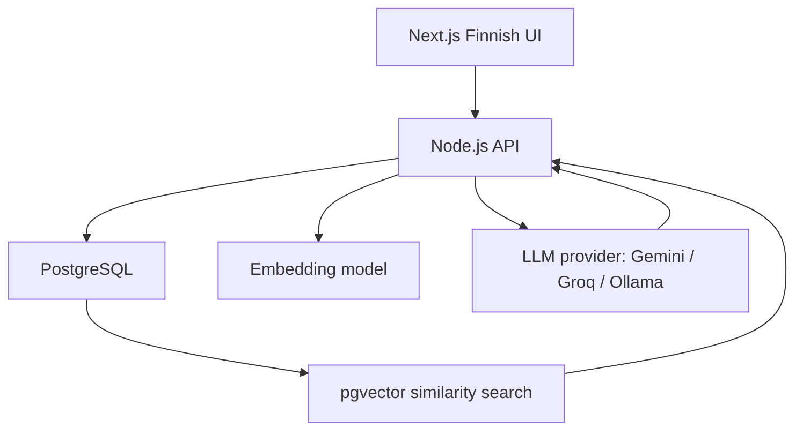

<div align="center">

# 🎓 JalaCampus AI

**A Finnish-language, AI-powered university knowledge assistant — built as a professional higher-education portfolio project.**


*Designed and maintained by **Jussi Alanen** · [juzapala@gmail.com](mailto:juzapala@gmail.com)*

</div>

---

## ✨ Overview

JalaCampus AI is a university-oriented demo that aims to make study guides, course information and campus instructions easier to find. The final concept combines a **Finnish-language chat interface**, **retrieval-augmented generation (RAG)**, **PostgreSQL + pgvector**, and an exchangeable LLM provider.

> [!IMPORTANT]
> **Current status:** This repository includes a responsive UI and a session-only PDF/TXT document preview. Persistent document ingestion, AI, embeddings, PostgreSQL and RAG **are planned**, not implemented. The interface deliberately avoids fabricated answers and citations.

### 🧭 Demo features

| | Module | Status |
| --- | --- | --- |
| 💬 | Finnish chat UI | ✅ UI scaffold |
| 📄 | PDF/TXT document preview | ✅ Session-only demo |
| 🗃️ | Persistent document catalog & ingestion | 🗓️ Planned |
| 🔎 | Semantic document retrieval (RAG) | 🗓️ Planned |
| 📚 | Course information API | 🗓️ Planned |
| 🛡️ | Grounded answers and source citations | 🗓️ Planned |
| ⚙️ | Configurable model provider | 🗓️ Planned |

## 🎨 Visual language

A professional **light-only** interface: clean white surfaces, `#F8FAFC` background, `#2563EB` primary blue, `#0F172A` text and `#E2E8F0` borders. Built with **Tailwind CSS v4**, responsive layouts and Lucide icons. **All user-facing copy is in Finnish**; source code and engineering documentation are in English.

## 🧱 Architecture (target)



The flow above describes the **target architecture**, not the current state. For the demo, use only synthetic or appropriately licensed public sample documents. Do not include real student records or secrets.

## 🚀 Quick start

Requires Node.js 20.9+ (Node.js 22 LTS recommended).

```bash
npm install
npm run dev
```

Open [http://localhost:3000](http://localhost:3000).

```bash
npm run lint
npm run typecheck
npm test
npm run build
```

`.env.example` documents **future** configuration; no API key is required to run the UI scaffold.

## 📄 Document preview

The **Dokumentit** tab accepts synthetic or licensed public PDF and UTF-8 TXT samples up to 2 MB. A Node.js route extracts up to 10 PDF pages and returns at most 20,000 characters for preview. The document list stays in the current page session only; files are not persisted, indexed, or sent to an AI provider. The demo has no admin authentication, so do not upload student records or other private material.

## 🗃️ Vector storage foundation

M2 begins with a PostgreSQL/pgvector migration in `db/migrations/001_documents.sql` and a deterministic Unicode-safe text chunker. The migration is **not applied automatically** and no database, ingestion API, embeddings, or semantic search is available yet. Its vector column intentionally has no fixed dimension until an embedding model is chosen.

### Local PostgreSQL with Docker

Run `docker compose up -d` to start the local PostgreSQL/pgvector service and `docker compose down` to stop it. The named volume keeps data between restarts; `docker compose down -v` also deletes local database data. Then apply `db/migrations/001_documents.sql` using `psql`. Set `POSTGRES_PASSWORD` in a local, untracked environment file before starting the container. This database is for development only; Vercel needs a separately provisioned PostgreSQL service.

## ☁️ Vercel deployment

Import `jussipalanen/jalacampus-ai` into Vercel as a **Next.js** project. Use the repository root as the Root Directory, `main` as the Production Branch, Node.js **22.x**, and the default Next.js build and output settings. The current UI scaffold requires **no environment variables**. Do not add the values from `.env.example` until the corresponding server-side features exist.

Vercel creates Preview deployments for pull requests and a Production deployment for commits merged into `main`. Check that the first deployment finishes successfully, the page loads in Finnish on desktop and mobile, and the interface stays in its light theme. Keep the Vercel project private if the demo should not be publicly reachable; Vercel deployment protection is configured in the project dashboard, not by this repository.

No `vercel.json` is needed for the current Next.js app. The local `.vercel/` project link is ignored by Git.

## 🗂️ Project structure

```text
src/app/             Next.js app router and Finnish UI
.github/workflows/   Lightweight validation (lint, types, tests, build)
.github/             Pull request template and CODEOWNERS
README.md            Project overview
ROADMAP.md           Planned increments and acceptance criteria
AGENTS.md            Shared engineering instructions
CLAUDE.md            Claude Code entrypoint importing AGENTS.md
```

## 🌿 Development workflow

1. Create an issue for one small feature (see `ROADMAP.md`).
2. Create a `feat/<scope>` (or `fix/<scope>`) branch from `main`.
3. Implement and test the feature; do not mix unrelated changes.
4. Open a pull request and complete the checklist.
5. **A human reviewer must approve and merge.** Automation and agents must not self-approve or merge.
6. Prefer squash merges to keep the history readable.

GitHub Actions runs basic checks on every PR and on pushes to `main`. To **enforce** review before merge, configure the repository's branch protection/ruleset in GitHub Settings (require PR, at least one approval, and passing `verify` check). The files alone do **not** enforce approval.

## 🗺️ Roadmap

See [ROADMAP.md](ROADMAP.md) for milestones, proposed issue boundaries and acceptance criteria.

## 👤 Author

**Jussi Alanen** · [juzapala@gmail.com](mailto:juzapala@gmail.com)
